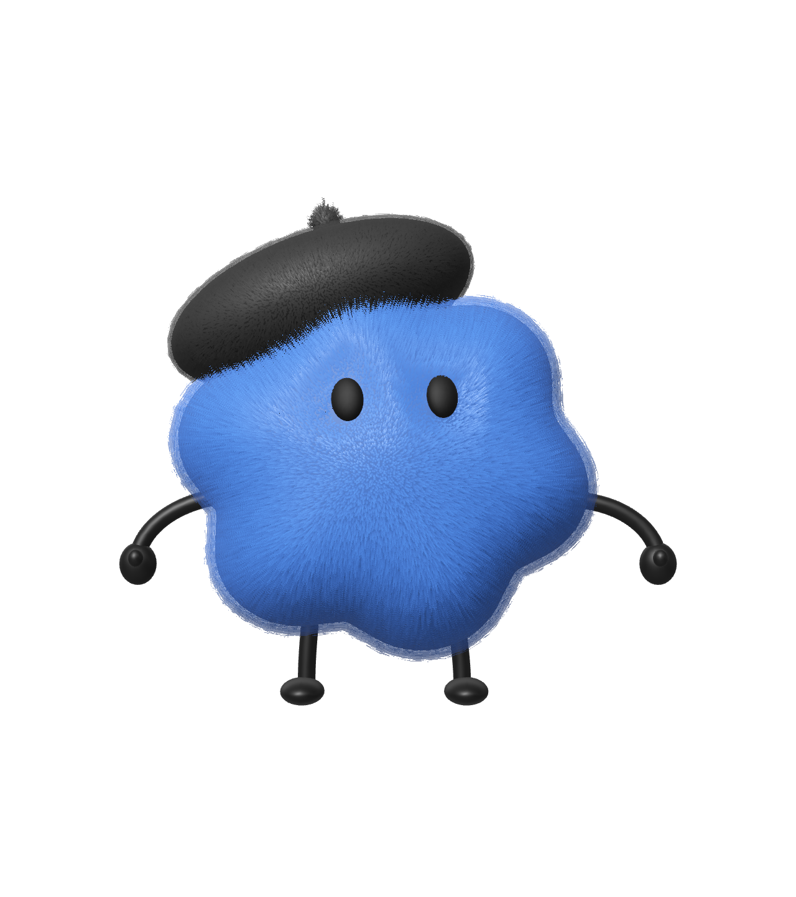
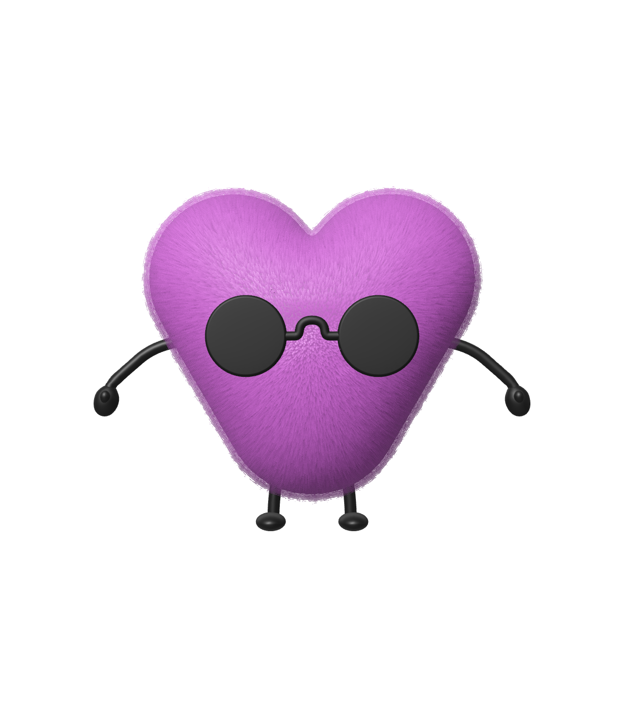

# Cast

**Little characters. Your world.**

Place a cast of tiny 3D characters in your room, give them names, and direct them by voice. They answer with expressive gestures and cartoon chirps. Live mode lets an OpenAI model choose what they do next from actions the scene can support.

Built for the [DevDay Exchange Community Hackathon, London](https://luma.com/dde-ldn-hack), 1 November 2026, with Codex.

<p>





</p>

## The experience

1. Open Cast on an iPhone and scan a clear, textured table or floor.
2. Tap a scanned horizontal surface. Swipe through the character carousel and add a character. Leave the name blank to use its avatar name.
3. Drag, pinch and rotate to place it, then press **Ready**. Add a friend on another clear spot.
4. Try **Actions → Wave**, **Dance**, **Jump**, or **Step right** without an API key.
5. Save your own OpenAI API key in Settings, then **Go live**. Say “Felipe, wave” or “Felipe and Alfred, face each other,” using the names you chose.
6. With Live connected and placement finished, the Decisions API chooses among currently available actions. Select a character or pause play to interrupt it; End live disconnects the microphone.

The characters make nonverbal sounds, not spoken dialogue. Their names and personalities persist; their AR placements currently do not.

## Demo and submission

The ≤90-second physical-device demo is being finished separately. This repository does not yet contain the final video. [Submission copy and demo checklist](docs/SUBMISSION.md) are included; do not mistake a simulator preview for a live AR demonstration.

## What OpenAI does

| Layer | Implementation |
| --- | --- |
| Spoken direction | OpenAI Realtime (`gpt-realtime-2.1`) receives microphone audio and calls a structured action tool with stable character IDs. |
| Autonomous choices | `POST /v1/decisions`, `gpt-6-luna`, selects from scene-generated choices such as wave, explore, inspect, jump, dance or greet. |
| Execution | Local validation rejects unknown targets, invalid parameters, stale decisions and unavailable actions. ARKit/RealityKit controls placement and movement. |
| Character sounds | On-device synthesis generates short hums and chirps, with model-selected mood and bounded expression. No TTS call is needed. |

Decisions uses measured geometry, proximity, lighting changes and recent actions. One request may be in flight, with a four-second minimum interval and error backoff. Voice input takes priority. This is **not visual recognition of everything in the room**: no camera images are sent to OpenAI, and approaching-person avoidance is not implemented.

Official references: [Realtime WebSockets](https://developers.openai.com/api/docs/guides/realtime-websocket), [Decisions](https://developers.openai.com/api/docs/guides/decisions), [RealityKit](https://developer.apple.com/documentation/realitykit).

## Build and run

**Requirements:** macOS, Xcode with the iOS SDK, XcodeGen, an Apple development signing team, and a physical ARKit-capable iPhone running iOS 18+. A LiDAR-equipped iPhone is recommended for room-mesh collisions. Development used Xcode 27 and an iPhone 17 Pro Max; older Xcode versions have not been validated. The Simulator supports UI/asset previews and tests, not real AR scanning.

```sh
git clone https://github.com/MustafaB3irat/Cast.git
cd Cast
brew install xcodegen
cp Config/Signing.example.xcconfig Config/Signing.xcconfig
# Set DEVELOPMENT_TEAM in the local Signing.xcconfig.
xcodegen generate
open Cast.xcodeproj
```

Select the **Cast** scheme and your iPhone. In Signing & Capabilities, choose your team and a unique bundle identifier if needed, then Run. Allow Camera. Microphone permission is requested when starting Live.

Alternatively, after configuring signing:

```sh
xcodebuild -project Cast.xcodeproj -scheme Cast \
  -destination 'generic/platform=iOS' -allowProvisioningUpdates build
```

**API setup:** In the app, open Settings, paste a key for an OpenAI project with the required model access and quota, and save it. It is stored in the iPhone Keychain with `WhenUnlockedThisDeviceOnly`; it is not compiled into the app. Offline actions need no API key. HTTP errors are displayed under Live instead of silently switching to local AI-like behaviour.

`Config/Secrets.example.xcconfig` documents the original brief's ignored secrets-file convention. Cast deliberately uses runtime Keychain entry instead; the template is not loaded into the app. Never put a shared key in source or an app bundle. A distributed production app should use an authenticated backend and appropriate short-lived credentials.

## Tests and current status

```sh
xcodebuild -project Cast.xcodeproj -scheme Cast \
  -destination 'platform=iOS Simulator,name=iPhone 17 Pro Max' test
```

Use an installed simulator name from `xcrun simctl list devices available` if yours differs.

- **26 unit tests passed** across the build-23 suite and its added imported-character movement regression test. Coverage includes command validation, all five USDZs, skeletal poses, movement math, scene snapshots, Decisions responses, cancellation and stale-response rejection.
- Simulator UI checks cover character picking, editing gestures, the cast gallery, connection settings and contextual controls.
- Build 23 compiles for iPhone and was installed on the physical test device.
- **Open issue:** previous builds animated walking without reliably travelling on the physical device. Build 23 replaces friction-driven walking with controlled, support/clearance-checked steps. Its final physical-device walking retest is pending. Do not claim this issue is verified fixed.
- Realtime/Decisions integration is implemented; model outputs and account access are tested with mocked transport locally. Full live behaviour is not certified by the automated suite.

See the [device checklist](docs/DEVICE_CHECKLIST.md). The earlier dynamic-body floor/wall experiment in `scripts/verify_locomotion.swift` does not validate build 23's complete AR walking controller.

## How it works

```text
Camera + ARKit → scanned surfaces / room mesh → available actions
Microphone → Realtime → named action tool ───────────────┐
Scene events → Decisions → selected feasible action ──┤
                                                     ↓
                                  validate → CastScene → movement + animation + chirps
```

- `CastScene.swift`: AR session, placement, gesture editing, support/clearance checks and action execution.
- `CharacterAnimator.swift`: procedural skeletal animation without replacing authored fur materials or flattening the model hierarchy.
- `CharacterPhysics.swift`: body configuration, bounded walking steps and impulses.
- `LiveDirector.swift` / `DecisionDirector.swift`: Realtime voice and autonomous fixed-choice decisions.
- `SceneAwareness.swift`: measured phone/character proximity and lighting events, with hysteresis.
- `CharacterVoice.swift`: deterministic character-specific nonverbal synthesis.

Walking uses a kinematic controller with small checked steps; jumps and other physical reactions use dynamic bodies. Geometry is an estimate, not a perfect replica. Characters do not have articulated ragdolls, general room pathfinding, moving-person tracking or persistent saved-room placement.

## Privacy

Camera frames stay on the device. While Live is active, microphone audio, character names/personalities, measured scene state and interaction context are sent to OpenAI. Local identities are stored in UserDefaults; imported USDZs live in application support. Backgrounding, interruption or ending Live stops the session; sessions also have a five-minute limit. Use fictional names for public demos. The repository includes no API keys, recordings of private rooms, saved world maps or personal photos.

## Built with Codex

Codex helped implement the native app, connect structured model choices to validated scene actions, preserve the skinned USDZ/fur hierarchy, and iterate against device feedback.

One concrete example: Go live crashed immediately. Codex inspected the iPhone crash report, traced it to a duplicate `name` key in a scene-description dictionary, removed it, and added a test that serializes a populated scene. [CODEX_NOTES.md](CODEX_NOTES.md) records this and the remaining validation limits.

The day began with **Pinmoir**, an AR memory-pinning idea, and pivoted to Cast. This repository contains Cast only; it does not claim Pinmoir's ARWorldMap persistence or voice-based memory placement.

## Credits and reuse

App and original character assets: **MustafaB3irat**. Iggy, Felipe, Todd, Alfred and Jojo were supplied by their creator; the five USDZs retain their authored 0.12 m height, feet pivot, skeletons and fur materials. Preview images are renders of those assets. Character chirps are synthesized by this project's code.

Design guidance: [unslop](https://heydamir.design/unslop), by [Damir Sokolovsky](https://x.com/heydamir), [CC BY 4.0](https://creativecommons.org/licenses/by/4.0/). Its guidance informed the UI; no skill source is bundled.

See [CREDITS.md](CREDITS.md) for provenance and [RIGHTS.md](RIGHTS.md) for reuse terms. Public source availability does not grant a blanket asset or source-code redistribution licence.
